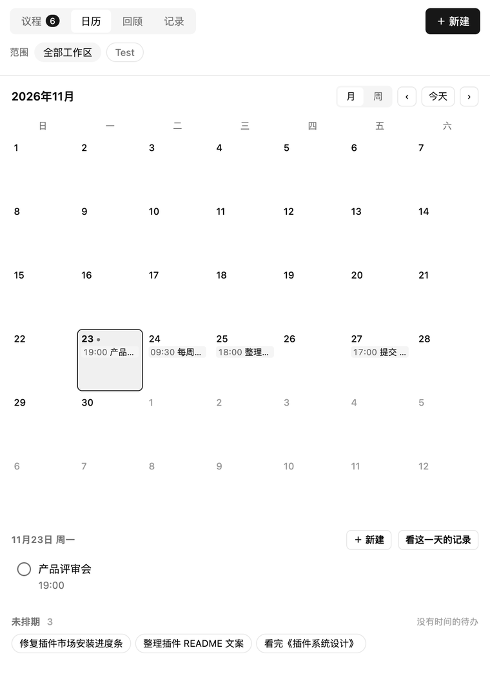

# PiWork-Plugin-Tasks

[简体中文](README.md) | English

**Official PiWork plugin · Planner · `com.pi.tasks`**

To-dos, calendar events, scheduled jobs, and daily notes on one timeline. An item with no time is a to-do; with a time it is an event; with a time, a repeat rule, and an action it is a scheduled job — the same thing in three shapes. Every item and every day note belongs to a workspace, or to **Global**; by default they land in the workspace of the current conversation, so the same “standup” in two projects is two unrelated items.

## The planner in PiWork



## What it does

- **Four views** — **Agenda** groups by today / tomorrow / this week / later / undated; **Calendar** shows the schedule as a month grid or week columns; **Review** is an automatic day summary plus the user's own writing; **History** shows scheduled-job firing history.
- **One item, three shapes** — an undated to-do can gain a time to become an event, then gain a repeat rule and an action to become a scheduled job, without being recreated.
- **Repeat and reminders** — `daily` / `weekly` / `monthly` / `yearly`, or a raw RRULE (for example the last Friday of every month); notify a configurable number of minutes before.
- **Let the agent act at the due time** — `onDue` holds a sentence for the agent (for example “summarize yesterday's commits”). If a window is open at that moment it enters the conversation; if not, the firing is recorded as undelivered and left for the user.
- **Daily review** — the top half automatically lists what was planned, what was done, and what was missed that day; the bottom half is free text written by the user. When the user says “tidy up today”, the agent can `day_read` first and then `day_write`.
- **Completion is per occurrence** — ticking off a repeating item affects only this occurrence; next week's is still open.
- **Missed firings are not lost** — a firing whose moment passed while the app was closed is recorded as **missed** and listed next time, for the user to re-run if they want.

## Install in PiWork

1. Open the PiWork desktop app.
2. Right panel → **Plugin Center** → **Planner** → Install.
3. The first install shows the permission list; after confirmation the package is downloaded and verified (sha256).

Develop from source:

```bash
git clone https://github.com/PiWorkAgent/PiWork-Plugin-Tasks
cd PiWork-Plugin-Tasks
npm install
npm run build        # backend dist/main.mjs + panel ui-dist/panel
npm test
```

Live-reload inside the PiWork repository:

```bash
PI_DEV_PLUGINS=/path/to/PiWork-Plugin-Tasks pnpm dev:desktop:plugins
```

## Usage in conversation

| You say | What happens |
| --- | --- |
| “Note that the product review is tomorrow at 3 pm” | `item_add` records an event and echoes the parsed time |
| “Standup every Monday at 9:30, remind me ten minutes before” | a scheduled job with a repeat rule and an advance notification |
| “What do I have today?” | `item_list` shows items for today / this week with their next firing time |
| “Delete the rent item” | `item_remove` (or `item_update` to mark it done) |
| “Tidy up today” | `day_read` reads today's done / missed items → `day_write` writes a two-sentence summary |
| “What did I do last week?” | `day_read` reads any range within the last 90 days |

## Tools

| Tool | Purpose |
| --- | --- |
| `item_add` | Add an item; `when` decides to-do vs. event, and `repeat` / `remindBefore` / `onDue` turn it into a scheduled job |
| `item_list` | List items for today / this week / all, with repeat rule, completion state, and next firing time |
| `item_update` | Match by title substring and change the given fields; pass an empty `when` to remove the time |
| `item_remove` | Delete an item; unless the user explicitly says delete, prefer marking it done |
| `day_read` | Read one day or a range: done, planned, missed, and the user's own text |
| `day_write` | Write the user's note for a day; append by default, replace only when explicitly asked |

Full semantics (free-text time parsing, workspace rules, trigger boundaries) are in [PLUGIN.md](./PLUGIN.md).

## Permissions

| Permission | Purpose |
| --- | --- |
| `storage` | Items, completion records, firing history, daily notes |
| `notify` | In-app / system notifications at the due time |

## Boundaries

- **Nothing fires while the app is closed.** This is a desktop app, not a system alarm; missed firings are recorded and offered for re-run the next time the app opens.
- **“Let the agent do something” needs an open window.** If no window is open at the due time, the firing is recorded as undelivered.
- **No external calendar integration.** It does not read or write the system calendar, Google Calendar, or CalDAV.
- Notifications are in-app + system notifications, not SMS or email.
- **Day notes never enter the agent's context automatically.** Use `day_read` when needed; do not pretend to remember what the user wrote.

## Release

1. Bump `version` in `manifest.json`
2. Commit and push a `v<version>` tag (or Actions → Release → Run workflow)

Release assets: `com.pi.tasks-<version>.zip` + `index.json`.

## Layout

| Path | Purpose |
| --- | --- |
| `manifest.json` | Plugin manifest: id, version, `apiVersion`, permissions, panels, tools |
| `src/core/` | Pure logic: time parsing, recurrence, triggers, day pages |
| `src/backend/` | Backend: state, tools, timer |
| `src/ui/panel/` | Panel (React + esbuild) |
| `dist/`, `ui-dist/` | Build artifacts (`dist/` committed, `ui-dist/` not committed) |
| `assets/` | Runtime icons |
| `media/` | README demo assets (not shipped in the release) |
| `scripts/release.mjs` | Packaging + single-entry index generation |

## Links

- [PiWork](https://github.com/PiWorkAgent/PiWork) — the host app
- [PiWork-Registry](https://github.com/PiWorkAgent/PiWork-Registry) — marketplace index
- [Plugin development guide](https://github.com/PiWorkAgent/PiWork-Plugin-Docs/blob/main/docs/plugin-dev-guide.md)
- [PLUGIN.md](./PLUGIN.md) — the agent-facing usage guide
