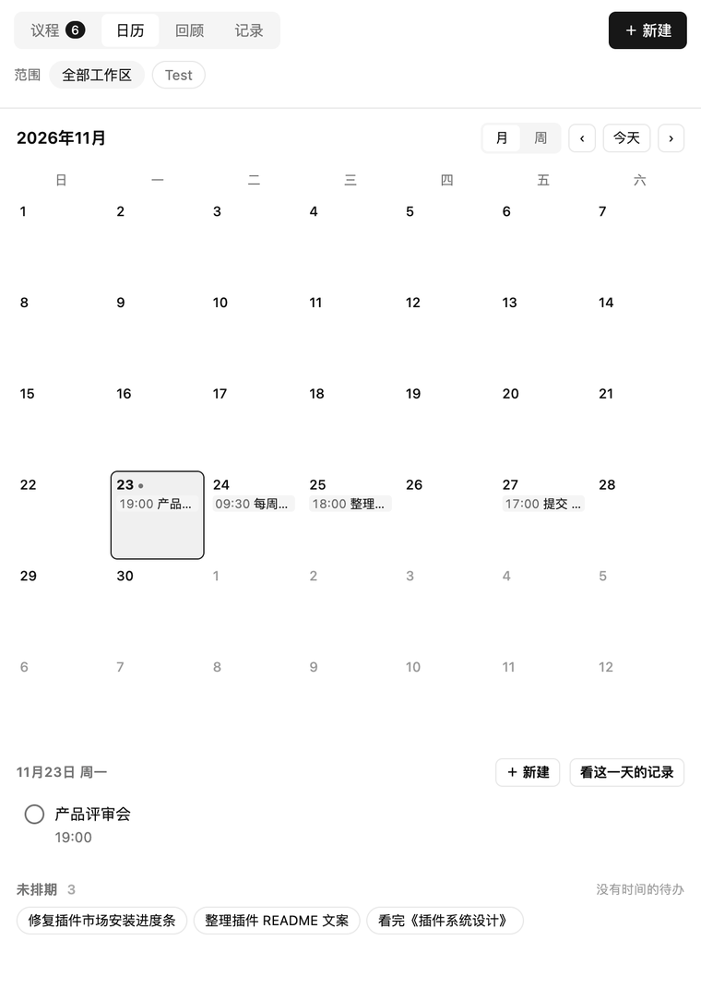

# PiWork-Plugin-Tasks

[English](README.en.md) | 简体中文

**PiWork 官方插件 · 日程本 · `com.pi.tasks`**

待办、日程、定时任务和每日记录放在同一个时间线上。没有时间的是待办，有时间的是日程，有时间 + 重复 + 动作的是定时任务——它们只是同一种事项的三种形态。每条事项和每段日记都归属一个工作区，或者属于「全局」；默认落在当前对话所在的工作区，所以同一个「站会」在两个项目里是两条互不相干的事项。

## PiWork 中的日程本



## 能做什么

- **四种视图** ——「议程」按今天 / 明天 / 本周 / 以后 / 无日期分组；「日历」用月历或周列看排期；「回顾」是一天自动汇总 + 用户手写记录；「记录」查看定时任务的触发历史。
- **三合一事项** —— 一条纯待办可以随时加上时间变成日程，再加上重复规则和触发动作就变成定时任务，不需要重新创建。
- **重复与提醒** —— 支持 `daily` / `weekly` / `monthly` / `yearly`，也可以直接写 RRULE（例如每月最后一个周五）；可以提前 N 分钟发系统通知。
- **到点让 agent 干活** —— `onDue` 可以写一句话给 agent（例如「总结昨天的提交」）。到点时如果窗口开着，它会进入对话；窗口没开则记成「没送到」，等用户决定。
- **每日回顾** —— 上半页自动列出那天计划了什么、完成了什么、错过了什么；下半页是用户自己写的一段文字。用户说「把今天整理一下」时，agent 可以先 `day_read` 再 `day_write`。
- **按「每一次」完成** —— 重复事项标记完成只影响这一次，下周的还在。
- **错过不丢** —— 应用没运行时到点的触发会被记成「错过」，下次打开时列出来，由用户决定要不要补跑。

## 在 PiWork 里安装

1. 打开 PiWork 桌面端。
2. 右侧栏 →「插件中心」→「日程本」→ 安装。
3. 首次安装会显示权限清单；确认后下载并校验（sha256）。

从源码开发：

```bash
git clone https://github.com/PiWorkAgent/PiWork-Plugin-Tasks
cd PiWork-Plugin-Tasks
npm install
npm run build        # 后端 dist/main.mjs + 面板 ui-dist/panel
npm test
```

在 PiWork 仓库里实时调试：

```bash
PI_DEV_PLUGINS=/path/to/PiWork-Plugin-Tasks pnpm dev:desktop:plugins
```

## 对话里的用法

| 你说 | 会发生什么 |
| --- | --- |
| 「记一下，明天下午三点开产品评审会」 | `item_add` 记成日程，回显解析出的时间 |
| 「每周一早上九点半站会，提前十分钟提醒我」 | 带重复规则和提前通知的定时任务 |
| 「我今天有什么事」 | `item_list` 按今天 / 本周列出事项和下次触发时间 |
| 「把房租那条删了」 | `item_remove`（或 `item_update` 标完成） |
| 「把今天整理一下」 | `day_read` 读取当天完成 / 错过 → `day_write` 写入两三句总结 |
| 「我上周干了什么」 | `day_read` 读取最近 90 天内任意一段日期 |

## 工具

| 工具 | 作用 |
| --- | --- |
| `item_add` | 新增事项；`when` 决定是待办还是日程，`repeat` / `remindBefore` / `onDue` 让它变成定时任务 |
| `item_list` | 列出事项：今天 / 本周 / 全部，含重复规则、完成状态、下次触发时间 |
| `item_update` | 按标题包含匹配，修改指定字段；`when` 传空字符串可去掉时间 |
| `item_remove` | 删除事项；除非用户明确要删，优先标完成 |
| `day_read` | 读取某一天或一段日期的完成、计划、错过和用户手写内容 |
| `day_write` | 写用户那一天的记录；默认追加，只有明确要求才覆盖 |

完整语义（自由文本时间解析、工作区规则、触发边界）见 [PLUGIN.md](./PLUGIN.md)。

## 权限

| 权限 | 用途 |
| --- | --- |
| `storage` | 事项、完成记录、触发历史、每日记录 |
| `notify` | 到点发应用内 / 系统通知 |

## 边界

- **应用关闭时不会触发。** 这是桌面应用，不是系统闹钟；错过的触发会被记下来，下次打开时由用户决定是否补跑。
- **「让 agent 干活」需要窗口开着。** 到点时窗口没开，这次会记成「没送到」。
- **不连外部日历。** 不读写系统日历、Google Calendar 或 CalDAV。
- 到点发的是应用内 + 系统通知，不是短信或邮件。
- **日记内容不会自动进入 agent 的上下文。** 需要时用 `day_read` 读，不要假装记得用户写过什么。

## 发布

1. 改 `manifest.json` 的 `version`
2. 提交并推送 tag `v<version>`（或 Actions → Release → Run workflow）

Release 资产：`com.pi.tasks-<version>.zip` + `index.json`。

## 目录

| 路径 | 说明 |
| --- | --- |
| `manifest.json` | 插件清单：id、版本、`apiVersion`、权限、面板、工具 |
| `src/core/` | 纯逻辑：时间解析、重复规则、触发、每日页 |
| `src/backend/` | 插件后端：状态、工具、定时器 |
| `src/ui/panel/` | 面板（React + esbuild） |
| `dist/`、`ui-dist/` | 构建产物（`dist/` 已提交，`ui-dist/` 不提交） |
| `assets/` | 运行时图标 |
| `media/` | README 演示素材（不进入发布包） |
| `scripts/release.mjs` | 打包 + 生成单条目索引 |

## 相关链接

- [PiWork](https://github.com/PiWorkAgent/PiWork) — 宿主应用
- [PiWork-Registry](https://github.com/PiWorkAgent/PiWork-Registry) — 插件市场索引
- [插件开发指南](https://github.com/PiWorkAgent/PiWork-Plugin-Docs/blob/main/docs/plugin-dev-guide.md)
- [PLUGIN.md](./PLUGIN.md) — 写给 agent 的使用说明
